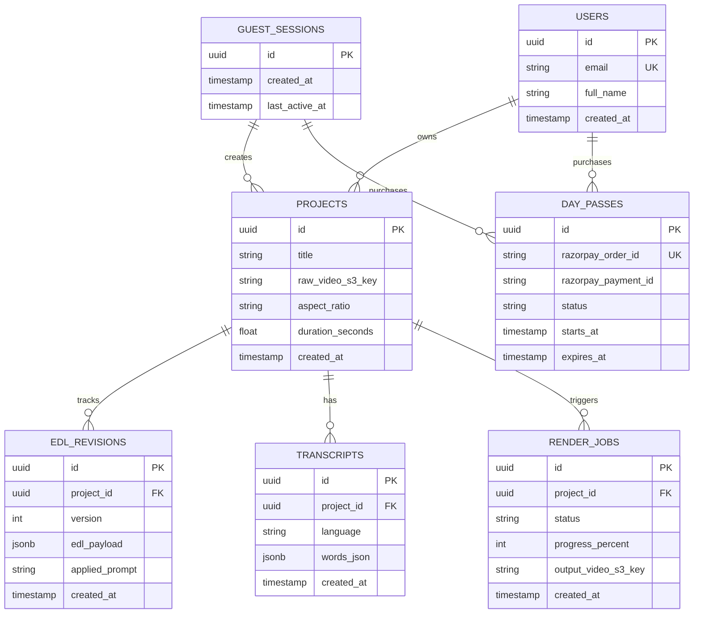

# VibeCut AI — Database Design Document

**Document Version:** 1.0  
**Target Release:** MVP Pilot  
**Database Engine:** PostgreSQL (via Supabase Free Tier)  

---

## 1. Overview & Architectural Principles

The database layer is designed to support high-throughput, low-latency video editing workflows with guest-first frictionless pilot testing, transitioning smoothly to authenticated creator accounts.

### Key Principles
1. **Zero-Cost Pilot (Free Tier Compatibility):** Optimized for Supabase PostgreSQL free tier (500 MB storage, 50,000 MAUs, pooled connections).
2. **Guest-to-User Polymorphism:** All entities (`projects`, `render_jobs`, `passes`) link to either a persistent authenticated `user_id` or a lightweight `session_id` (UUID generated on first visit), allowing creators to edit and test without signup friction.
3. **JSONB Document Storage for EDLs:** Edit Decision Lists (EDLs) and word-level speech transcripts are stored in high-performance `JSONB` columns, eliminating complex relational joins while preserving schema flexibility.
4. **Automated Lifecycle Pruning:** Expired guest projects and transient render job records are purged after 48 hours to prevent database bloat.

---

## 2. Entity Relationship Diagram (ERD)



---

## 3. Detailed Table Schemas

### 3.1. `guest_sessions`
Tracks anonymous creators exploring the app before signing up.
```sql
CREATE TABLE guest_sessions (
    id UUID PRIMARY KEY DEFAULT gen_random_uuid(),
    ip_hash TEXT,
    user_agent TEXT,
    created_at TIMESTAMPTZ DEFAULT NOW(),
    last_active_at TIMESTAMPTZ DEFAULT NOW()
);

CREATE INDEX idx_guest_sessions_last_active ON guest_sessions(last_active_at);
```

---

### 3.2. `users`
Profiles for registered creators (synchronized with Supabase Auth `auth.users`).
```sql
CREATE TABLE users (
    id UUID PRIMARY KEY REFERENCES auth.users(id) ON DELETE CASCADE,
    email TEXT UNIQUE NOT NULL,
    full_name TEXT,
    avatar_url TEXT,
    created_at TIMESTAMPTZ DEFAULT NOW(),
    updated_at TIMESTAMPTZ DEFAULT NOW()
);
```

---

### 3.3. `day_passes`
Tracks 24-hour UPI Creator Day Passes (₹99) and Pro subscriptions.
```sql
CREATE TABLE day_passes (
    id UUID PRIMARY KEY DEFAULT gen_random_uuid(),
    session_id UUID REFERENCES guest_sessions(id) ON DELETE SET NULL,
    user_id UUID REFERENCES users(id) ON DELETE SET NULL,
    plan_type TEXT NOT NULL DEFAULT 'day_pass_99', -- 'day_pass_99' | 'pro_monthly_799'
    amount_inr_paise INTEGER NOT NULL DEFAULT 9900, -- ₹99.00 = 9900 paise
    razorpay_order_id TEXT UNIQUE NOT NULL,
    razorpay_payment_id TEXT UNIQUE,
    status TEXT NOT NULL DEFAULT 'created',        -- 'created' | 'paid' | 'failed' | 'expired'
    starts_at TIMESTAMPTZ,
    expires_at TIMESTAMPTZ,
    created_at TIMESTAMPTZ DEFAULT NOW(),

    CONSTRAINT chk_owner_present CHECK (session_id IS NOT NULL OR user_id IS NOT NULL)
);

CREATE INDEX idx_day_passes_active ON day_passes(session_id, user_id, expires_at)
    WHERE status = 'paid';
```

---

### 3.4. `projects`
Core video project entity storing media metadata and storage references.
```sql
CREATE TABLE projects (
    id UUID PRIMARY KEY DEFAULT gen_random_uuid(),
    session_id UUID REFERENCES guest_sessions(id) ON DELETE SET NULL,
    user_id UUID REFERENCES users(id) ON DELETE SET NULL,
    title TEXT NOT NULL DEFAULT 'Untitled Reel',
    raw_video_s3_key TEXT NOT NULL,
    file_size_bytes BIGINT NOT NULL,
    aspect_ratio TEXT NOT NULL DEFAULT '9:16',    -- '9:16' | '1:1' | '16:9'
    width INTEGER NOT NULL DEFAULT 1080,
    height INTEGER NOT NULL DEFAULT 1920,
    duration_seconds REAL NOT NULL DEFAULT 0.0,
    status TEXT NOT NULL DEFAULT 'ready',         -- 'uploading' | 'ready' | 'archived'
    created_at TIMESTAMPTZ DEFAULT NOW(),
    updated_at TIMESTAMPTZ DEFAULT NOW(),

    CONSTRAINT chk_project_owner CHECK (session_id IS NOT NULL OR user_id IS NOT NULL)
);

CREATE INDEX idx_projects_session ON projects(session_id);
CREATE INDEX idx_projects_user ON projects(user_id);
```

---

### 3.5. `transcripts`
Stores the word-level speech recognition result generated by Groq Whisper.
```sql
CREATE TABLE transcripts (
    id UUID PRIMARY KEY DEFAULT gen_random_uuid(),
    project_id UUID NOT NULL REFERENCES projects(id) ON DELETE CASCADE,
    language TEXT NOT NULL DEFAULT 'en',           -- 'en' | 'hi' | 'ta' | 'te'
    full_text TEXT NOT NULL,
    -- JSONB Array: [{ word: string, start: float, end: float, confidence: float }]
    words_json JSONB NOT NULL DEFAULT '[]'::jsonb,
    created_at TIMESTAMPTZ DEFAULT NOW()
);

CREATE INDEX idx_transcripts_project ON transcripts(project_id);
```

---

### 3.6. `edl_revisions`
Stores the chronological timeline state (cuts, kinetic subtitles, ducked audio, and FX) enabling undo/redo and AI copilot prompt diffing.
```sql
CREATE TABLE edl_revisions (
    id UUID PRIMARY KEY DEFAULT gen_random_uuid(),
    project_id UUID NOT NULL REFERENCES projects(id) ON DELETE CASCADE,
    revision_number INTEGER NOT NULL DEFAULT 1,
    applied_prompt TEXT,                          -- E.g. "AI: Made intro faster and added whoosh"
    -- Complete EditDecisionList JSON document
    edl_payload JSONB NOT NULL,
    created_at TIMESTAMPTZ DEFAULT NOW(),

    CONSTRAINT uq_project_revision UNIQUE (project_id, revision_number)
);

CREATE INDEX idx_edl_project ON edl_revisions(project_id, revision_number DESC);
```

---

### 3.7. `render_jobs`
Tracks serverless rendering tasks running on AWS Lambda FFmpeg workers.
```sql
CREATE TABLE render_jobs (
    id UUID PRIMARY KEY DEFAULT gen_random_uuid(),
    project_id UUID NOT NULL REFERENCES projects(id) ON DELETE CASCADE,
    edl_revision_id UUID REFERENCES edl_revisions(id) ON DELETE SET NULL,
    status TEXT NOT NULL DEFAULT 'queued',        -- 'queued' | 'processing' | 'completed' | 'failed'
    resolution TEXT NOT NULL DEFAULT '1080p',     -- '720p' | '1080p'
    include_watermark BOOLEAN NOT NULL DEFAULT true,
    progress_percent INTEGER NOT NULL DEFAULT 0,
    output_video_s3_key TEXT,
    error_message TEXT,
    render_duration_ms INTEGER,
    created_at TIMESTAMPTZ DEFAULT NOW(),
    completed_at TIMESTAMPTZ
);

CREATE INDEX idx_render_jobs_status ON render_jobs(status, created_at);
CREATE INDEX idx_render_jobs_project ON render_jobs(project_id);
```

---

## 4. Row-Level Security (RLS) Policies

To protect creator privacy while enabling frictionless guest sessions:

```sql
-- Enable RLS on all tables
ALTER TABLE guest_sessions ENABLE ROW LEVEL SECURITY;
ALTER TABLE projects ENABLE ROW LEVEL SECURITY;
ALTER TABLE transcripts ENABLE ROW LEVEL SECURITY;
ALTER TABLE edl_revisions ENABLE ROW LEVEL SECURITY;
ALTER TABLE render_jobs ENABLE ROW LEVEL SECURITY;
ALTER TABLE day_passes ENABLE ROW LEVEL SECURITY;

-- Project Access Policy (Owner or matching Guest Session)
CREATE POLICY "Projects accessible by owner or guest session" ON projects
    FOR ALL
    USING (
        (auth.uid() IS NOT NULL AND auth.uid() = user_id)
        OR
        (session_id = NULLIF(current_setting('request.headers', true)::json->>'x-session-id', '')::uuid)
    );

-- Render Jobs Access Policy
CREATE POLICY "Render jobs accessible by project owner" ON render_jobs
    FOR SELECT
    USING (
        EXISTS (
            SELECT 1 FROM projects
            WHERE projects.id = render_jobs.project_id
            AND (
                (auth.uid() IS NOT NULL AND auth.uid() = projects.user_id)
                OR
                (projects.session_id = NULLIF(current_setting('request.headers', true)::json->>'x-session-id', '')::uuid)
            )
        )
    );
```

---

## 5. Storage Pruning Strategy (Zero-Cost Maintenance)

To guarantee the database never exceeds the 500 MB free tier limit:
1. **Guest Project Pruning:** Projects belonging to guest sessions inactive for $>48\text{ hours}$ are automatically scheduled for deletion via a Postgres function.
2. **Transient Job Cleanup:** Completed or failed `render_jobs` older than 7 days are purged.

```sql
-- Database Auto-Prune Function
CREATE OR REPLACE FUNCTION purge_expired_guest_data()
RETURNS void AS $$
BEGIN
    -- Delete guest projects inactive for > 48 hours
    DELETE FROM projects
    WHERE user_id IS NULL
    AND updated_at < NOW() - INTERVAL '48 hours';

    -- Delete old completed render job logs > 7 days
    DELETE FROM render_jobs
    WHERE created_at < NOW() - INTERVAL '7 days';
END;
$$ LANGUAGE plpgsql;
```
