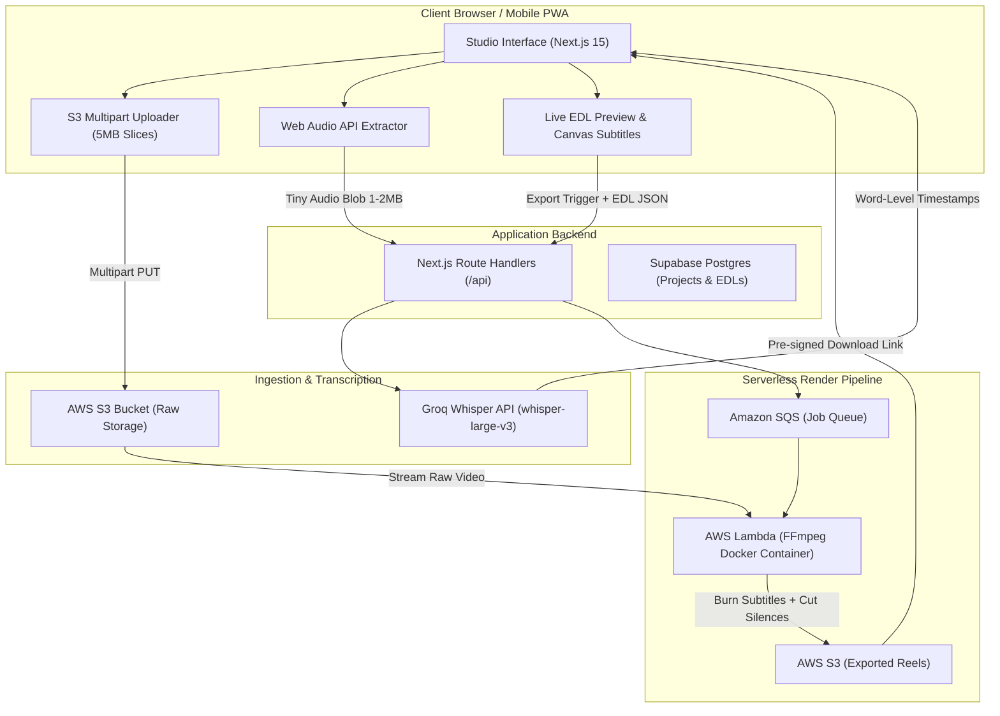

# VibeCut AI — System Architecture Document

**Document Version:** 1.0  
**Target Release:** MVP Pilot  
**Author:** Engineering Team  

---

## 1. System Vision & Architectural Principles

VibeCut AI is an AI-powered, browser-first automated video editing studio engineered for creators in high-growth, mobile-first markets (such as India).

### Core Architectural Principles
1. **Zero-Friction Ingestion:** Videos upload via resilient chunked multipart uploads directly to cloud storage, eliminating proxy bottlenecks and surviving intermittent cellular connections.
2. **Decoupled Preview vs. Final Render:** The user interacts with zero latency in the browser using an Edit Decision List (EDL) and dynamic Canvas overlays. Heavy FFmpeg re-encoding only occurs on final export.
3. **Pay-per-Second Serverless Compute:** Leverages AWS Lambda containers for video rendering to eliminate idle server costs and maximize the lifespan of cloud credits.
4. **Optimized for Social Algorithms:** Video styles, aspect ratios (9:16 primary, 1:1, 16:9), and kinetic captions are pre-calibrated for maximum viewer retention on Instagram Reels and YouTube Shorts.

---

## 2. End-to-End System Diagram



---

## 3. Detailed Component Architecture

### 3.1. Ingestion Pipeline: Resilient S3 Chunked Upload
To handle 100 MB–250 MB videos over unstable cellular connections without failure:
* **Chunk Sizing:** Videos are sliced into **5 MB chunks** using the browser `File.slice()` API.
* **Multipart Handshake:**
  1. Frontend calls `/api/upload/initiate` $\rightarrow$ AWS S3 returns an `UploadId`.
  2. Frontend requests pre-signed URLs for each 5 MB part.
  3. Chunks upload in parallel (up to 3 concurrent connections).
  4. If a single chunk fails due to network drop, only that 5 MB slice retries.
  5. Upon completion, frontend calls `/api/upload/complete` $\rightarrow$ S3 automatically reassembles the parts into one canonical MP4 file at zero compute cost.

### 3.2. Audio Extraction & Sub-Second Transcription
* Instead of uploading the heavy 150 MB video to the transcription API, the client's browser extracts the audio track into a lightweight 16kHz mono audio blob (~1 MB for a 60s video) using standard `AudioContext` / `OfflineAudioContext`.
* The audio blob is dispatched to **Groq Cloud API (`whisper-large-v3`)**:
  * **Latency:** ~1.2 to 1.8 seconds for 60 seconds of speech.
  * **Output Format:** `verbose_json` with word-level timestamps (`start`, `end`, `word`).
  * **Language Support:** English, Hindi, Hinglish, Tamil, Telugu.

### 3.3. In-Browser Live Preview (The Edit Decision List - EDL)
Rather than re-encoding the video on every user cut:
* The app maintains an **Edit Decision List (EDL)** in local client state:
  ```json
  {
    "sourceUrl": "blob:... or s3://...",
    "aspectRatio": "9:16",
    "cuts": [
      { "start": 0.0, "end": 4.2 },
      { "start": 5.1, "end": 12.8 }
    ],
    "removedPauses": [
      { "start": 4.2, "end": 5.1, "duration": 0.9 }
    ],
    "subtitles": {
      "preset": "hormozi",
      "font": "Montserrat-Black",
      "activeColor": "#FACC15",
      "inactiveColor": "#FFFFFF"
    },
    "audio": {
      "bgmTrack": "lofi-beat-01.mp3",
      "bgmVolume": 0.25,
      "autoDucking": true,
      "duckAmountDb": -18,
      "sfx": [
        { "timestamp": 4.2, "type": "whoosh.mp3", "volume": 0.8 },
        { "timestamp": 8.5, "type": "pop.mp3", "volume": 0.7 }
      ]
    },
    "visualEffects": [
      { "timestamp": 4.2, "effect": "punch_zoom", "scale": 1.15, "duration": 0.4 },
      { "timestamp": 8.5, "effect": "glitch_impact", "duration": 0.3 }
    ]
  }
  ```
* During playback, a lightweight time-update watcher skips past deleted pauses seamlessly.
* Subtitles are rendered on a high-performance transparent Canvas overlay on top of the `<video>` element, achieving 60fps kinetic animations with zero rendering delay.
* Web Audio API handles client-side multi-track audio mixing and dynamic ducking during live preview without re-encoding.

### 3.4. The "Prompt-to-Edit" AI Copilot Engine
Modeled after modern AI coding assistants (e.g., Cursor, Claude Code) that read code ASTs and apply diffs:
* The user types natural language prompts (e.g., *"Make the intro faster, add a whoosh sound at second 3, and add subtle glitch on my key takeaway"*).
* An LLM agent (Google Gemini 2.5 Flash / Groq Llama 3.3) takes the current **EDL JSON** and user prompt, reasons over speech timestamps, and outputs an **EDL Diff**.
* The client state applies the diff deterministically, allowing users to undo/redo or chain multiple natural language edits on the fly.

### 3.5. Serverless Render Pipeline (AWS Lambda + FFmpeg)
When the user clicks **"Export Reel"**:
1. Next.js pushes the render payload (S3 File Key + EDL JSON) to an Amazon SQS queue.
2. An AWS Lambda function running an optimized FFmpeg container triggers:
   * **Filter Graph:**
     * `select` / `aselect` filter to cleanly slice non-deleted segments.
     * Dynamic `zoompan` and glitch/color matrices for visual FX.
     * `ass` (Advanced SubStation Alpha) subtitle filter for kinetic text.
     * `sidechaincompress` audio filter for automatic background music ducking against voice track.
     * `amix` to composite speech + ducked BGM + triggered SFX.
   * **Hardware Acceleration:** Uses AWS Graviton2 (ARM64) Lambda architecture for 20% lower cost and faster vector execution.
3. The rendered MP4 is saved to `s3://vibecut-exports/` with a 24-hour expiration link returned to the client.

---

## 4. Subtitle Styles & Social Algorithm Optimization

Social platforms (Instagram, TikTok, YouTube Shorts) reward retention and completion rate. Subtitles are designed specifically to prevent user scroll-away:

| Preset Name | Target Audience | Visual Characteristics | Algorithm Purpose |
| :--- | :--- | :--- | :--- |
| **Hormozi Retention** | Business, Tech, Coaches | Uppercase Montserrat Black, bright yellow active word, 3px black stroke, subtle bounce animation. | High contrast readability without sound; maximum retention. |
| **Creator Kinetic (MrBeast Style)** | Entertainment, Vlogs | Dynamic multi-color (Green/Yellow/Cyan), context-aware auto-emojis, 2-word display window. | Visual pacing to combat short attention spans. |
| **Minimalist Clean** | Aesthetic, Lifestyle, Podcasts | Sentence case Inter SemiBold, translucent dark backdrop pill, smooth fade-in. | Professional, non-intrusive viewing experience. |

### Multi-Format Aspect Ratio Support
* **9:16 (1080x1920):** Default format for Instagram Reels, Shorts, TikTok.
* **1:1 (1080x1080):** Square format for Instagram Feed and LinkedIn video posts.
* **16:9 (1920x1080):** Landscape format for long-form YouTube.

---

## 5. Storage Lifecycle & AWS Credit Protection

To ensure the $100 AWS credit lasts through months of pilot testing:
1. **S3 Lifecycle Rules:**
   * `raw-uploads/`: Automatically delete files after **48 hours**.
   * `rendered-exports/`: Automatically delete after **24 hours**.
   * *Rationale:* Once the user downloads their Reel, there is no need to pay persistent storage fees.
2. **Zero-Idle Policy:**
   * No EC2 instances.
   * No persistent databases on AWS (Supabase Free Tier handles metadata).
   * Lambda runs strictly on-demand.
3. **Bandwidth Management:**
   * In-browser preview runs on local object URLs, consuming **0 bytes** of AWS download egress during the editing process. Cloud bandwidth is consumed only once during final export download.

---

## 6. Implementation Stages

* **Stage 1 (Documentation & Contracts):** System architecture (this doc), API interface contracts, and S3 CORS policies.
* **Stage 2 (Ingestion & STT Service):** S3 Multipart upload handlers and Groq Whisper audio pipeline.
* **Stage 3 (Canvas Preview & Subtitle Engine):** Client-side synchronized word playback with trending subtitle styles.
* **Stage 4 (Lambda FFmpeg Worker):** Containerized video rendering backend for cloud exports.
* **Stage 5 (Pilot Paywall & Telemetry):** UPI Day Pass verification modal and conversion tracking.
