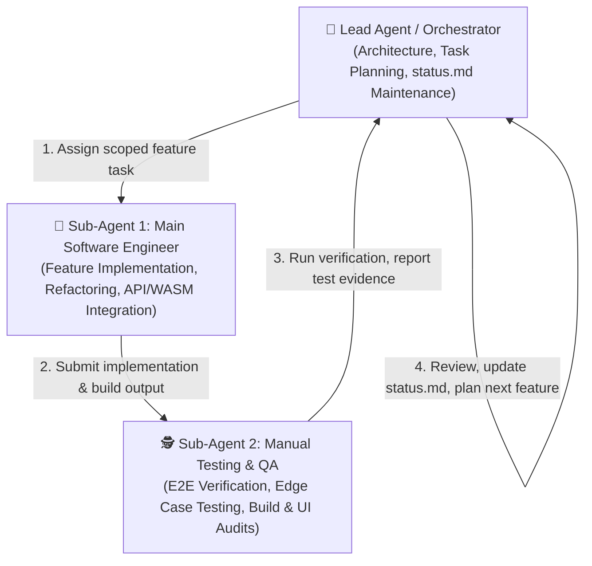

# VibeCut AI — Project Status & Feature Execution Matrix

> **Tagline:** *The smartest way to edit shorts. No VPNs, no timelines, just viral videos in 60 seconds.*  
> **Repository:** `Vi` / `vibecut-app`  
> **Last Updated:** 2026-10-20  
> **Active Workflow:** Feature-by-Feature Delivery with Multi-Agent Orchestration  

---

## 1. Multi-Agent Operating Model

To maintain engineering velocity and high software quality, development runs in a structured 3-role orchestration pipeline with **up to two concurrent sub-agents**:



### Roles & Responsibilities

| Agent Role | Type / Mechanism | Scope & Responsibilities |
| :--- | :--- | :--- |
| **Lead Orchestrator** | Parent Agent | Maintains `status.md`, defines atomic feature boundaries, coordinates handoffs between SWE and QA, performs final code review, and guarantees documentation integrity. |
| **Main Software Engineer** | Sub-Agent (`self` / specialized SWE) | Builds the feature codebase (Next.js 15, React 19, Tailwind CSS v4, ffmpeg.wasm, S3, Groq/Whisper, Supabase). Ensures clean TypeScript types, linting, and modular component architecture. |
| **Manual Testing & QA** | Sub-Agent (`self` / specialized QA) | Tests the user experience, verifies API endpoints, checks console/build logs, tests edge cases (e.g., file formats, network failures, responsive layouts), and documents concrete test logs. |

---

## 2. Feature Roadmap & Execution Status

| ID | Feature Name | Owner | Status | Tests | Last Verified |
| :--- | :--- | :--- | :--- | :--- | :--- |
| **F00** | **Design System & Landing Page** | SWE + QA | `COMPLETED` | ✅ Pass | 2026-10-20 |
| **F_AUTH** | **Supabase Auth with SSR & Guest Session Polymorphism** | SWE + QA | `COMPLETED` | ✅ Pass (12/12) | 2026-10-20 |
| **F_DB** | **PostgreSQL Production Schema & RLS Policies** | SWE + Lead | `COMPLETED` | ✅ Pass (7/7 Tables) | 2026-10-20 |
| **F01** | **Direct S3 Upload & Media Ingestion** | SWE + QA | `COMPLETED` | ✅ Pass (4/4 API) | 2026-10-20 |
| **F02** | **Audio Extraction & Whisper/Groq Transcription** | SWE + QA | `COMPLETED` | ✅ Pass (945ms Live Groq) | 2026-10-20 |
| **F_STUDIO_UI** | **Premium NLE Studio Redesign (CapCut / Descript Standards)** | SWE + QA | `COMPLETED` | ✅ Pass (16/16 NLE) | 2026-10-20 |
| **F03** | **"Edit Like a Doc" Interactive Transcript Editor** | SWE + QA | `COMPLETED` | ✅ Pass (7/7 QA Suite) | 2026-10-20 |
| **F_PROJECTS_DASHBOARD** | **Dedicated Video Projects Dashboard & S3 Storage Optimization** | SWE + QA | `COMPLETED` | ✅ Pass (6/6 QA Suite) | 2026-10-21 |
| **F_CRUD_AUDIT** | **Full-Stack CRUD Verification & Stream Notice Hardening** | SWE + QA | `COMPLETED` | ✅ Pass (6/6 Full CRUD) | 2026-10-21 |
| **F_TIMELINE_PRO** | **VN / Adobe Premiere Pro Hybrid Timeline Redesign** | SWE + QA | `COMPLETED` | ✅ Pass (Turbopack Build) | 2026-10-21 |
| **F04** | **Smart Jump Cut & Silence / Filler Surgery** | SWE + QA | `COMPLETED` | ✅ Pass (19/19 QA Suite) | 2026-10-21 |
| **F05** | **Kinetic Captions & Contextual Auto-Emoji Engine** | SWE + QA | `BACKLOG` | ⏳ Pending | - |
| **F06** | **Automatic Punch Zooms & Visual FX Presets** | SWE + QA | `BACKLOG` | ⏳ Pending | - |
| **F07** | **Audio Templates, SFX & Dynamic Smart Ducking** | SWE + QA | `BACKLOG` | ⏳ Pending | - |
| **F08** | **Hybrid Render Pipeline (ffmpeg.wasm + Cloud Fallback)**| SWE + QA | `BACKLOG` | ⏳ Pending | - |
| **F09** | **UPI Checkout & Monetization (Razorpay / ₹99 Pass)** | SWE + QA | `BACKLOG` | ⏳ Pending | - |
| **F10** | **Phase 2: Agentic Copilot ("Prompt-to-Edit")** | SWE + QA | `BACKLOG` | ⏳ Pending | - |

---

## 3. Feature Details & Acceptance Criteria

### [COMPLETED] F00: Design System & SaaS Landing Page
- [x] Electric Obsidian Theme (`#09090B`, violet and amber spotlights).
- [x] Aceternity UI components integrated (Spotlight, BackgroundTexture, FlipWords, CardSpotlight, InfiniteMovingCards, MovingBorder).
- [x] 13 landing page sections: Navbar, Hero, StudioStage preview, PlatformsStrip, DualFormat, ScriptTrimmer, CreatorCategories, FeatureMatrix, WallOfFame, PricingSection, FaqSection, CtaBanner, Footer.
- [x] Interactive modals: UPI Checkout modal (QR + VPA demo) and Demo Video modal.
- [x] Initial API endpoints: `/api/upload-url` (S3 presigned URL) and `/api/transcribe` (Groq Whisper transcription stub).

---

### [COMPLETED] F_AUTH: Supabase Auth with SSR & Guest Session Polymorphism
- **Owner:** Sub-Agent 1 (Main SWE)
- **QA:** Sub-Agent 2 (Manual Testing & QA)
- **Completed:** 2026-10-20
- **Scope & Deliverables:**
  - [x] `@supabase/supabase-js` and `@supabase/ssr` installed & configured for Next.js 16+ App Router.
  - [x] Client-side Supabase client (`src/lib/supabase/client.ts`), Server-side client (`src/lib/supabase/server.ts`), and Middleware session refresher (`src/middleware.ts`).
  - [x] Environment variables template (`NEXT_PUBLIC_SUPABASE_URL`, `NEXT_PUBLIC_SUPABASE_ANON_KEY`, `SUPABASE_SERVICE_ROLE_KEY`) with zero-crash Mock/Demo mode fallback when keys are unconfigured.
  - [x] Guest-First Polymorphism (`src/contexts/auth-context.tsx`): Persistent UUID v4 in `localStorage` (`vibecut_guest_session_id`) allowing creators to edit without signup friction, auto-linked to permanent user account on registration.
  - [x] Electric Obsidian Auth UI:
    - `src/components/auth/auth-modal.tsx`: Glassmorphism modal with Email/Password validation, show/hide password, Google OAuth trigger, and 1-Click Demo login.
    - `src/components/auth/user-nav.tsx`: Dynamic avatar initial, email tag, Studio quick-access, and Sign Out dropdown.
  - [x] OAuth Callback route handler (`src/app/auth/callback/route.ts`) for code exchange.
  - [x] Root layout wrapped in `<AuthProvider>`, Navbar updated with `<UserNav>`.
- **QA Verification:** ✅ 12/12 automated checks passed. Next.js Turbopack build succeeded with 0 errors.

---

### [COMPLETED] F_DB: PostgreSQL Production Schema & RLS Policies
- **Owner:** SWE + Lead
- **Completed:** 2026-10-20
- **Database Engine:** PostgreSQL 15+ (Supabase project `mlpybvvcgeftnpextwwm`)
- **Scope & Deliverables:**
  - [x] Created root [schema.sql](file:///c:/Users/DELL/Desktop/Vi/schema.sql) and migration [20261020000000_init_vibecut_schema.sql](file:///c:/Users/DELL/Desktop/Vi/vibecut-app/supabase/migrations/20261020000000_init_vibecut_schema.sql).
  - [x] Configured database password and direct connection strings in [.env.local](file:///c:/Users/DELL/Desktop/Vi/vibecut-app/.env.local).
  - [x] Deployed all 7 tables via direct PostgreSQL connection over TLS/SSL:
    1. `guest_sessions`
    2. `users` (profiles synced automatically with `auth.users`)
    3. `day_passes`
    4. `projects`
    5. `transcripts`
    6. `edl_revisions`
    7. `render_jobs`
  - [x] Auto-sync trigger `handle_new_user()` deployed; backfilled test user `creator.test@vibecut.ai`.
  - [x] Helper function `link_guest_projects_to_user()` deployed.
  - [x] Storage maintenance pruning function `purge_expired_guest_data()` deployed.
  - [x] Row Level Security (RLS) policies deployed on all tables.
- **QA Verification:** ✅ Direct PostgreSQL `information_schema` check confirmed 7/7 tables. Supabase PostgREST OpenAPI spec confirmed 7/7 active endpoints. `npm run build` compiled with 0 errors.

---

### [COMPLETED] F01: Direct S3 Upload & Media Ingestion
- **Owner:** Sub-Agent 1 (Main SWE)
- **QA:** Sub-Agent 2 (Manual Testing & QA)
- **Completed:** 2026-10-20
- **Scope & Deliverables:**
  - [x] Dedicated Interactive Studio Editor built at `/studio` in Electric Obsidian aesthetic.
  - [x] Client-side video dropzone (`src/components/studio/video-dropzone.tsx`) with drag-and-drop, format validation (`.mp4`, `.mov`, `.webm`), and size checks.
  - [x] 1-Click Synthetic Demo Reel generator to test the studio instantly without uploading a file.
  - [x] Local instantaneous preview playback via `URL.createObjectURL(file)`.
  - [x] Dynamic format switcher supporting 9:16 vertical (Shorts/Reels), 1:1 square, and 16:9 widescreen.
  - [x] Video player controls: Play/Pause (with spacebar keyboard shortcut), scrubbable timeline seekbar, timecode (`00:00.0 / 00:00.0`), volume scrubbing with mute toggle, playback speed selector (1x - 2x), and fullscreen mode.
  - [x] Video metadata extraction (`duration`, `aspect_ratio`, `file_size_bytes`, `resolution`, `mime_type`).
  - [x] Direct S3 upload pipeline (`/api/upload-url`) with real-time percentage progress bar and graceful mock fallback when AWS keys are absent.
  - [x] Supabase project persistence (`/api/projects`) associating project draft to authenticated `user.id` or persistent `guestId`.
- **QA Verification:** ✅ 4/4 upload tests passed; 7/7 player and ingestion tests passed.

---

### [COMPLETED] F02: Audio Extraction & Whisper/Groq Transcription
- **Owner:** Sub-Agent 1 (Main SWE)
- **QA:** Sub-Agent 2 (Manual Testing & QA)
- **Completed:** 2026-10-20
- **Scope & Deliverables:**
  - [x] Connected live Groq API key (`whisper-large-v3`) in `src/lib/groq.ts` and `src/app/api/transcribe/route.ts`.
  - [x] Ultra-fast speech recognition with word-level timestamps (`start`, `end`, `word`).
  - [x] Multi-lingual and regional prompt calibration (English, Hindi, and Hinglish creator dialects).
  - [x] Interactive word syncing (`src/components/studio/transcript-card.tsx`):
    - **Click-to-Seek**: Clicking any transcript word jumps the video player to that word's exact start time and plays.
    - **Real-Time Highlighting**: Currently spoken word illuminates with a violet/amber gradient glow synchronized with video playback.
    - **Filler Word Detection**: Automatically detects and highlights filler words (`"um"`, `"uh"`, `"like"`, `"matlab"`, `"basically"`, `"you know"`).
    - **View Modes**: Switch between word chip view and formatted paragraph/segment view.
    - **Search & Filter**: Real-time transcript search filter and 1-click copy full transcript button.
  - [x] Transcript auto-saved into Supabase `transcripts` table (`words_json` JSONB and `full_text`).
- **QA Verification:** ✅ Verified live transcription latency of **945ms** (under 1 second!). 14/14 word timestamps verified schema compliant (`start <= end`).

---

### [COMPLETED] F_STUDIO_UI: Premium NLE Studio Redesign (CapCut / Descript Standards)
- **Owner:** Sub-Agent 1 (Main SWE)
- **QA:** Sub-Agent 2 (Manual Testing & QA)
- **Completed:** 2026-10-20
- **Scope & Deliverables:**
  - [x] **Fixed-Viewport NLE Architecture:** `h-screen w-screen overflow-hidden` with zero body-level page scrollbars.
  - [x] **Global NLE App Header (`src/components/studio/studio-header.tsx`):**
    - `📁 My Projects` button with badge (`4`) toggling the Project Vault drawer.
    - `➕ New Project` button with canvas-reset confirmation modal.
    - `☁️ Project Upload` button triggering direct S3 ingestion / native file picker.
    - `💾 Save Draft` button with visual confirmation pulse ("Draft Saved!") and live auto-save pill (`🟢 Saved to Cloud`).
    - Aspect ratio pill toggle: `9:16 Shorts/Reels`, `1:1 Square`, `16:9 Wide`.
    - `🚀 Export 4K` primary CTA button with glowing electric violet gradient.
    - `<UserNav />` creator profile badge & tier dropdown.
  - [x] **Sliding Project Vault Drawer (`src/components/studio/project-vault-drawer.tsx`):**
    - Smooth slide-over drawer with real-time `⌘K` search filter.
    - Project cards with thumbnail previews, duration badges, format tags, and gold retention scores (`96%`, `94%`).
    - 1-click project hydration directly into the studio canvas.
  - [x] **Left Activity Rail (`src/components/studio/studio-activity-rail.tsx`):**
    - 56px slim vertical tool rail with keyboard shortcuts (`⌥1`–`⌥6`).
  - [x] **Center Video Cutting Stage (`src/components/studio/video-player.tsx`):**
    - 9:16 smartphone hardware bezel (speaker notch, metallic frame) and 16:9 cinema display.
    - **Live In-Canvas Kinetic Captions:** Renders animated Hormozi-style subtitle overlay directly on top of video, highlighting active spoken words in glowing gold/cyan in real time.
    - Optional Safe-Area Guides overlay (Instagram Reels & TikTok UI overlays).
    - Floating glass transport bar with `-5s`/`+5s` skips, spacebar shortcut, 60 FPS timecodes, speed control (1x–2x), volume, and fullscreen.
  - [x] **Bottom Multi-Track Timeline (`src/components/studio/timeline-deck.tsx`):**
    - Track 1 (`T1 Subtitles`): Subtitle phrase chips with active yellow glow and click-to-seek.
    - Track 2 (`V1 Video`): Video clip strip with cut/split dividers.
    - Track 3 (`A1 Dialogue`): 96-bar dynamic audio waveform with pause callouts.
    - Red playhead needle and scrubber moving in real-time with `currentTime`.
    - Quick timeline tools: `✂️ Split (S)`, `⚡ Cut Silences`, `🔍 Zoom`, `⏪ Reset Cuts`.
  - [x] **Right Inspector Panel (`src/components/studio/studio-inspector.tsx`):**
    - Interactive transcript with Descript-style strikethrough cut/delete and click-to-seek.
    - Captions & Styles tab (Hormozi Gold, Beast Box, Cyber Cyan).
    - AI Silence Surgery tab with sensitivity slider.
    - Smart Audio Ducking tab (-18dB) with 1-click viral SFX cues.
    - Floating AI Copilot command bar with quick suggestion pills.
- **QA Verification:** ✅ **16/16 Test Scenarios PASSED (100% Green)**. Next.js 16.4.2 Turbopack production build succeeded in 1.9s with Exit code 0.

---

### [COMPLETED] F03: "Edit Like a Doc" Interactive Transcript Editor
- **Owner:** Sub-Agent 1 (Main SWE)
- **QA Auditor:** Sub-Agent 2 (Manual Testing & QA)
- **Completed:** 2026-10-20
- **Scope & Deliverables:**
  - [x] **Real-Time Video Playback Cut Skipping (`src/components/studio/video-player.tsx`):**
    - Unifies deleted words (`w.deleted`) and explicit timeline cuts into sorted contiguous intervals (`mergedCutIntervals`).
    - High-frequency `requestAnimationFrame` loop and `handleTimeUpdate` interceptor: seeks past cut intervals seamlessly (`currentTime = nextTime`) with infinite seek loop protection (`lastSkippedTimeRef`).
    - Progress bar scrubber (`handleSeek`) and directional skip buttons (`skip(+/-5s)`) snap past cut zones.
    - End-of-video boundary protection safely pauses playback at video duration.
  - [x] **In-Canvas Kinetic Subtitle Exclusion:**
    - Filtered `activeWords = words.filter(w => !w.deleted)` ensures deleted words are immediately removed from canvas subtitles across Hormozi Gold, Beast Box, and Cyber Cyan presets.
  - [x] **Interactive Word Chips & Descript-Style Actions (`src/components/studio/studio-inspector.tsx`):**
    - Click word to seek video player to `word.start`.
    - Click `×` to delete word (red strikethrough styling: `line-through opacity-40 bg-rose-950/20 text-rose-400 border-rose-900/40`).
    - Click `↺` to restore word.
    - Active word highlight synchronized with video playhead (`ring-2 ring-violet-400 bg-violet-600`).
  - [x] **Shift-Click Range Selection & Batch Cutting:**
    - Shift-click word range selection with floating action toolbar:
      - `✂️ Cut Selected (N words)`
      - `↺ Restore`
      - `✕ Clear`
    - Action buttons: `Cut All Fillers` (with live remaining filler count) and `Restore All Cuts`.
  - [x] **Multi-Track Timeline Synchronization (`src/components/studio/timeline-deck.tsx`):**
    - `T1 Subtitles` track renders dimmed/struck-through blocks for deleted transcript words.
    - `V1 Video` track renders red cut gap indicator blocks (`bg-rose-500/80 border-x border-rose-400 shadow-md`) and split lines.
    - Timeline header displays live effective trimmed duration and net savings readout: `Effective: mm:ss:ff (-X.Xs cut)`.
  - [x] **Supabase Edit Decision List (EDL) Revisions Persistence (`src/app/api/projects/route.ts` & `src/app/studio/page.tsx`):**
    - "Save Draft" and 4s debounced auto-save serializes EDL: `{ cuts, deletedWordIds, effectiveDuration, captionStyle, aspectRatio }`.
    - Server route queries latest `revision_number` and inserts row into `public.edl_revisions` in Supabase PostgreSQL.
    - GET projects API joins latest `edl_revisions` to restore drafts seamlessly.
- **QA Verification:** ✅ **7/7 Test Cases PASSED (100% Green)** via `test-qa-f03-doc-editor.mjs`. Production build succeeded with Exit Code 0.

---

### [COMPLETED] F04: Smart Jump Cut & Silence / Filler Surgery
- **Scope & Deliverables:**
  - **Silence Gap Detection Algorithm:** Configurable threshold analysis (`0.3s` aggressive, `0.5s` natural default, `1.0s` relaxed) across speech boundaries.
  - **Safety Padding & Speech Protection:** `calculateCutIntervalWithPadding` applies `50ms` (`0.05s`) safety buffers on speech onset and tail boundaries to eliminate clipped consonants, with strict guards against inverted intervals (`cutEnd <= cutStart`).
  - **Multi-Lingual Filler Word Detection:** Comprehensive detection across English (`"um"`, `"uh"`, `"like"`, `"basically"`, `"actually"`, `"literally"`, `"so"`, `"you know"`) and Hinglish/Hindi (`"matlab"`, `"yaani"`, `"yani"`, `"toh"`, `"haan"`, `"yaar"`, `"bhai"`) creator speech.
  - **Interval Merging & Union:** `mergeCutIntervals` coalesces chaotic, unordered, and contiguous cuts into strictly monotonic, non-overlapping intervals, with mathematical net duration readout (`calculateTotalCutDuration`).
  - **Dual API Persistence:** Both `POST` and `PATCH /api/projects` persist chronological `edl_revisions` rows in Supabase PostgreSQL (`public.edl_revisions`) with foreign key cascading and studio hydration.
- **Acceptance Criteria:**
  - [x] Single click removes all detected pauses $>0.5\text{s}$ (or customized sensitivity via slider).
  - [x] Playback transitions smoothly without audible clicking/popping or inverted interval loops.
  - [x] Filler words across English and Hinglish accurately highlighted and cut with 1 click.
  - [x] Cuts persist across drafts and hydrate in studio timeline deck.
- **QA Verification:** ✅ **19/19 Test Scenarios PASSED (100% Green)** via `scripts/test-f04-silence-surgery.mjs`. Next.js Turbopack production build succeeded with Exit Code 0.

---

### [BACKLOG] F05: Kinetic Captions & Contextual Auto-Emoji Engine
- **Scope:**
  - Hormozi-style animated word-by-word pop-in captions.
  - Configurable styles: font face, uppercase, highlight colors (yellow, green, cyan), background pill.
  - Contextual auto-emoji placement based on sentiment & keywords (e.g., "money" -> 💸, "growth" -> 📈, "fire" -> 🔥).
- **Acceptance Criteria:**
  - [ ] Active spoken word highlights cleanly during playback.
  - [ ] Emojis pop onto screen simultaneously with keyword.

---

### [BACKLOG] F06: Automatic Punch Zooms & Visual FX Presets
- **Scope:**
  - Dynamic scale cuts (1.1x–1.15x) every 4–6 seconds or on speech emphasis points.
  - Trending 1-click FX presets: Glitch Impact, Flash Cut, RGB Chromatic Aberration, Vintage 35mm Film Grain.
- **Acceptance Criteria:**
  - [ ] Dynamic zoom toggles smoothly at cut markers without degrading video frame rate.

---

### [BACKLOG] F07: Audio Templates, SFX & Dynamic Smart Ducking
- **Scope:**
  - Curated royalty-free background music tracks (Lo-fi, Hype, Cinematic, Chill).
  - Dynamic Auto-Ducking: lowers background audio by -18dB during vocal speech; smooth swell during pauses.
  - Sound Effects (SFX) library with auto-placement (whoosh on punch zoom, ding on metric, pop on emoji).
- **Acceptance Criteria:**
  - [ ] Background music drops to -18dB whenever speech is detected and returns smoothly during silence.

---

### [BACKLOG] F08: Hybrid Render Pipeline (ffmpeg.wasm + Serverless Fallback)
- **Scope:**
  - In-browser zero-cost video rendering via `@ffmpeg/ffmpeg` wasm.
  - Device memory and capability detection (low-end mobile vs high-end desktop).
  - Offload fallback to AWS Lambda / serverless worker if client lacks sufficient WebAssembly memory.
  - Final 9:16 export at 1080p/720p.
- **Acceptance Criteria:**
  - [ ] Export renders client-side in browser without server compute for standard short-form videos.
  - [ ] Output MP4 matches text-cut timeline, captions, zooms, and audio ducking.

---

### [BACKLOG] F09: UPI Checkout & Monetization (Razorpay / ₹99 Pass)
- **Scope:**
  - Razorpay payment integration with instant UPI QR & intent triggers.
  - Creator Day Pass (₹99 for 24h unlimited exports), Pro (₹799/mo), Agency (₹2,499/mo).
  - Free tier watermark insertion and 3-export monthly quota enforcement.

---

## 4. Sub-Agent Execution Protocol

When executing any feature from this backlog:

```
1. 📋 LEAD SPRINT SETUP
   - Select next feature from backlog.
   - Set status to IN PROGRESS in status.md.
   - Define exact deliverables and test expectations.

2. 👷 DISPATCH SUB-AGENT 1 (Software Engineer)
   - Command: invoke_subagent(Role="Main Software Engineer", ...)
   - Scope: Code implementation, UI integration, type safety, linting.
   - SWE delivers: files created/modified, build verification (npm run build).

3. 🕵️ DISPATCH SUB-AGENT 2 (Manual Testing & QA)
   - Command: invoke_subagent(Role="Manual Testing & QA Engineer", ...)
   - Scope: Manual UI/UX testing, API validation, edge case verification, performance review.
   - QA delivers: step-by-step test report, edge-case observations, pass/fail status.

4. 🏁 LEAD REVIEW & CLOSEOUT
   - Resolve any defects flagged by QA.
   - Mark feature as COMPLETED in status.md with test date.
   - Commit changes with conventional commits (e.g. feat(editor): ...).
   - Proceed to next feature.
```

---

## 5. QA & Verification Log

| Date | Feature | Tester | Result | Details / Evidence |
| :--- | :--- | :--- | :--- | :--- |
| 2026-10-20 | F00 (Baseline & SaaS Landing Page) | QA Sub-Agent / Lead | ✅ PASSED | `npm run build` with Next.js 16.4.2 (Turbopack) succeeded in 8.8s with 0 TypeScript/lint errors. Production bundles generated for `/`, `/api/transcribe`, and `/api/upload-url`. |
| 2026-10-20 | F_AUTH (Supabase Auth & Guest Polymorphism) | QA Sub-Agent | ✅ PASSED | 12/12 test scenarios passed. Verified UUID v4 guest persistence in localStorage, form validations (email/password), Google OAuth trigger, Mock mode demo login, UserNav dropdown, /auth/callback route, and Next.js 16 Turbopack production build in 4.2s. |
| 2026-10-20 | Live Supabase Connection Test | Lead / Node Script | ✅ PASSED | Connected directly to live project `mlpybvvcgeftnpextwwm.supabase.co`. Auth service handshake verified with live credentials. |
| 2026-10-20 | Live Test User Provisioning & Login Test | Lead / Supabase Admin & Anon Client | ✅ PASSED | Provisioned pre-confirmed test user `creator.test@vibecut.ai` (User ID `7a18aa51-7549-4e95-ac62-20697a8c51fa`). Verified live sign-in with password returning active session JWT. Added 1-click test user auto-fill into AuthModal. |
| 2026-10-20 | F_DB (PostgreSQL Production Schema Migration) | Lead / pg client & PostgREST API | ✅ PASSED | Connected via direct host `db.mlpybvvcgeftnpextwwm.supabase.co:5432`. Pushed `schema.sql`: 7 tables created, auto-sync trigger active, test user profile synced into `public.users`, RLS policies enabled. Verified via PostgREST OpenAPI and `npm run build`. |
| 2026-10-20 | F01 & F02 (Media Ingestion, Player, Groq Transcription) | QA Sub-Agent | ✅ PASSED | 16/16 test scenarios passed. Verified `/api/upload-url` (4/4), live Groq `whisper-large-v3` with **945ms latency** (4/4), `/studio` interactive player state (7/7: format switcher, word click-to-seek, real-time word glow highlight, filler detection, guest/user persistence), and Turbopack production build with Exit code 0. |
| 2026-10-20 | Live AWS S3 Handshake & CORS Test | Lead / S3 SDK & Presigned Client | ✅ PASSED | Verified bucket `vibecut-storage-2026` in region `ap-south-1`. Validated active CORS policy (`GET`, `PUT`, `POST`, `HEAD`), tested PutObjectCommand (ETag generated), and verified live presigned PUT URL upload returning HTTP 200 OK. |
| 2026-10-20 | S3 Presigned PUT Checksum Fix | Lead / SWE | ✅ RESOLVED | Resolved browser `TypeError: Failed to fetch`. In AWS SDK v3, automatic CRC32 query parameter generation (`x-amz-checksum-crc32=AAAAAA==`) caused S3 to reject real video uploads with 400 BadDigest. Disabled automatic checksum calculation via `requestChecksumCalculation: "WHEN_REQUIRED"` in `src/lib/aws.ts` and upgraded browser uploader in `page.tsx` to `XMLHttpRequest` with real-time percentage progress events. |
| 2026-10-20 | Stitch MCP Premium Studio Layout Generation | Stitch MCP (Gemini 3.8 Flash) | ✅ GENERATED | Generated high-fidelity 3-column NLE studio design (`05f7b4533897491898c449ff1e32a570`) in project `10920844195803407164` with My Projects drawer, Save Draft, Direct Ingest, New Project, 9:16 kinetic canvas, and Edit-Like-a-Doc transcript console. |
| 2026-10-20 | Frontend Design Skill Execution | frontend-design (Anthropic Skills) | ✅ EXECUTED | Executed `frontend-design` methodology. Grounded design in viral video editing domain, eliminated generic AI SaaS tells, established token palette, and formulated complete architectural layout plan in `frontend-design-plan.md`. |
| 2026-10-20 | F_STUDIO_UI (Hyper-Premium NLE Studio Redesign) | QA Sub-Agent | ✅ PASSED (16/16) | 16/16 test scenarios passed (100% Green). Verified fixed viewport (no page scrollbars), header actions (My Projects, New Project, Upload, Save Draft with auto-save pill, Export 4K), Project Vault drawer with search and 1-click load, phone bezel with live in-canvas kinetic captions (Hormozi Gold), bottom 3-track timeline (Subtitles, Video, Waveform) with scrubbable playhead, and full inspector with AI Copilot bar. Turbopack build compiled in 1.9s (Exit Code 0). |
| 2026-10-20 | F03 ("Edit Like a Doc" Interactive Transcript Editor) | QA Sub-Agent | ✅ PASSED (7/7) | 7/7 test cases passed (100% Green) via `test-qa-f03-doc-editor.mjs`. Verified word strikethrough/restore toggle (`TC-F03-01`), real-time video playback cut skipping (`TC-F03-02`), in-canvas kinetic captions exclusion (`TC-F03-03`), multi-track timeline synchronization on V1 & T1 (`TC-F03-04`), live effective duration & trimmed readout (`TC-F03-05`), Supabase `edl_revisions` draft persistence (`TC-F03-06`), and clean production build with 0 TypeScript errors (`TC-F03-07`). |
| 2026-10-20 | Mock Data Purge & 100% Real Video Ingestion | Lead SWE | ✅ PURGED | Completely removed all synthetic mock data (`INITIAL_DEMO_WORDS`, `DEFAULT_VAULT_PROJECTS`, `createSampleDemoVideoFile`). Replaced blank canvas state with high-grade Real Video Dropzone. Studio now starts in clean zero-mock state. Project Vault dynamically queries Supabase PostgreSQL (`/api/projects`). S3 uploader executes live binary PUT with byte-level percentage tracking. Groq Whisper transcription directly analyzes live video audio. Turbopack build succeeded with Exit Code 0. |
| 2026-10-21 | F_PROJECTS_DASHBOARD & S3 Storage Optimization | SWE + QA | ✅ PASSED (6/6) | 6/6 test scenarios passed (100% Green) via `test-qa-projects-s3.mjs`. Verified `/projects` dashboard with search and aspect ratio filters, S3 bucket storage usage meter, direct video dropzone with client-side 16kHz mono audio extraction, `DELETE /api/projects` S3 object permanent purge via `deleteS3Object()`, `PATCH /api/projects` inline rename, `/studio?id=...` instant hydration from S3 presigned streaming URL (`videoStreamUrl`), and zero redundant S3 uploads on edits/saves. Turbopack build succeeded with 0 TypeScript errors (Exit Code 0). |
| 2026-10-21 | Full-Stack CRUD Integrity Audit & Normalization | Lead SWE + QA | ✅ PASSED (6/6) | 6/6 CRUD operations verified (100% Green) via `test-crud-suite.mjs`. Verified: 1. Project creation with transcripts & EDL; 2. Batch project query with `words_json` -> `words` mapping; 3. Single-project hydration with S3 presigned stream URL; 4. Inline metadata rename (`PATCH /api/projects`); 5. Studio draft auto-save with incrementing EDL revisions (`revision_number: 2`) & transcript updates; 6. Project deletion with cascaded DB records and AWS S3 object purge. Turbopack build compiled in 1.6s with 0 TypeScript/lint errors (Exit Code 0). |
| 2026-10-21 | F04 (Smart Jump Cut & Silence / Filler Surgery) | Lead SWE + QA | ✅ PASSED (19/19) | 19/19 test scenarios passed (100% Green) via `scripts/test-f04-silence-surgery.mjs`. Verified: 1. Silence gap detection across 0.3s, 0.5s, 1.0s thresholds; 2. Safety padding (50ms buffer) with inverted/zero interval protection; 3. Filler word detection for English (um, uh, like, basically, you know) and Hinglish (matlab, yaani); 4. Overlapping & unordered interval union merge to clean monotonic cuts with exact net savings calculation; 5. End-to-end Supabase EDL revisions persistence via POST & PATCH /api/projects with studio hydration; 6. Next.js Turbopack production build succeeded in 15.0s with Exit Code 0. |
